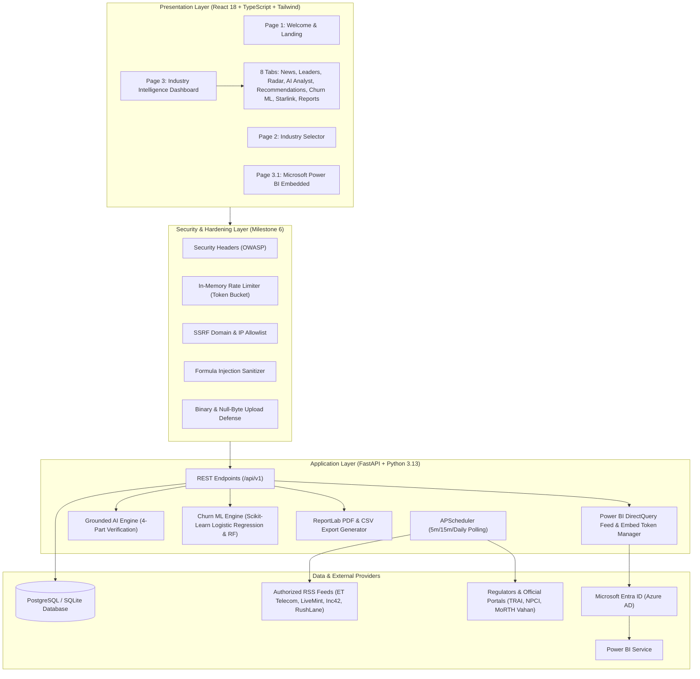

# GIANT: Real-Time Industry Intelligence and Customer Churn Prediction Platform

[](https://github.com/DhaneeshVijayanand/giant/actions/workflows/ci.yml)
[](https://fastapi.tiangolo.com)
[](https://react.dev)
[](https://www.typescriptlang.org)
[](https://www.postgresql.org)
[](https://pytest.org)

**Giant** is an enterprise-grade platform tailored for **Business Analysts, Product Managers, and Strategy Executives**. It unifies real-time industry intelligence across **Telecom**, **Fintech & Digital Payments**, and **Electric Vehicles (EV)** in India with calibrated Machine Learning for **Customer Churn Prediction** and deep **Microsoft Power BI** embedded visualizations.

---

## 1. System Architecture



---

## 2. Core Capabilities & Page Flow

### Page 1: Welcome & Landing (`/`)
- 5-second automatic countdown with interactive "Skip" button.
- Live system clock and date synchronization.
- High-contrast enterprise branding compliant with WCAG AA accessibility standards.

### Page 2: Industry Selection (`/industries`)
- Database-backed cards for:
  1. **Telecom** (Cellular, 5G, FTTH, Satellite Spectrum, TRAI updates)
  2. **Fintech & Digital Payments** (UPI volume, merchant transactions, RBI circulars)
  3. **Electric Vehicles (EV)** (2W/3W/4W adoption, Vahan registration trends, battery safety)
- Displays active article counts, top tracked companies, and direct routing.

### Page 3: Industry Intelligence Dashboard (`/industry/:slug`)
Comprises eight integrated analyst modules:
- **Section A: Live News Radar**: Authentic RSS articles with full deduplication clustering, duplicate counts, canonical source links, and 4 separate timestamps (Original Published, Platform Ingested, Last Scheduler Poll, and Next Check). Degraded source health alerts automatically display if an external feed fails.
- **Section B: Market Leaders & Benchmarks**: Real quarterly and monthly figures from official regulators (TRAI subscriber counts, NPCI UPI monthly transactions, MoRTH Vahan registrations).
- **Section C: Competitor Radar & Watchlist**: Full company monitoring matrix with persistent watchlist pinning stored in `localStorage`.
- **Section D: Grounded AI Business Analyst**: Chat assistant answering strictly from stored articles and official data using a 4-part grounded format:
  1. *Verified Facts* (with explicit article citations and URLs)
  2. *Strategic Implications*
  3. *Actionable Next Steps*
  4. *Evidence Gaps & Caveats*
  Equipped with spend caps, prompt injection sanitization, and deterministic fallbacks.
- **Section E: Strategic AI Recommendations**: High, Medium, and Low priority business recommendations with expected impact and evidence references.
- **Section F: Customer Churn Intelligence**: Calibrated Machine Learning module utilizing Logistic Regression and Random Forest classifiers. Features:
  - Benchmark IBM Telco demonstration dataset (strictly labeled **Demo data**).
  - Custom CSV dataset upload with MIME, size (10 MB), path traversal, and null-byte defenses.
  - Strict leakage prevention: Target column isolated, hold-out test evaluation, zero synthetic test inflation.
  - ROC-AUC, Precision, Recall, and F1-score evaluation metrics.
  - Feature Driver ranking (e.g. Month-to-Month contracts, Fiber optic tech, Tenancy).
  - Risk Distribution tiers (Low, Medium, High risk customer segments).
  - Privacy and data purge control (`DELETE /api/v1/churn/dataset`).
- **Section G: Featured Starlink Case Study ("Will Starlink Disrupt India's Telecom Market?")**:
  - 12 verified regulatory and commercial topics with official TRAI, DoT, and IN-SPACe citations.
  - 3 structured disruption scenarios:
    1. *High Disruption (Enterprise & Rural Monopoly)*
    2. *Moderate Coexistence (Backhaul Partner & Niche Luxury)*
    3. *Constrained Entry (High Terminal Cost & Strict Security Vetting)*
  - Transparent assumptions calculator with dynamic evidence feed.
- **Section H: Executive Reports & Exports**:
  - Multi-page PDF generation via ReportLab (executive summary, benchmarks, churn statistics, evidence tables).
  - CSV report export equipped with **OWASP Formula Injection Protection** (prepends single-quotes to dangerous `=,+,-,@` triggers).

### Page 3.1: Microsoft Power BI Embedded Analytics (`/industry/:slug/news-bi`)
- Built for enterprise Microsoft Power BI environments.
- Direct JSON and CSV reporting feed at `/api/v1/powerbi/data-feed` strictly sanitized of customer PII and secrets.
- Azure AD Service Principal embed token generation with automatic token renewal before expiration.
- Real dataset refresh timestamps displayed directly from Power BI Service.
- If credentials are not yet configured, cleanly renders an interactive setup prerequisite guide alongside a high-fidelity native fallback dashboard.

---

## 3. Security, Hardening & Quality Controls (Milestone 6)

| Security Category | Implementation Details | Verification Test |
|---|---|---|
| **Security Headers** | `X-Content-Type-Options: nosniff`, `X-Frame-Options: SAMEORIGIN`, `Referrer-Policy: strict-origin-when-cross-origin`, `Permissions-Policy`, and strict CSP allowing Power BI framing. | `test_security_headers_present` |
| **Rate Limiting** | In-memory sliding-window token bucket. Public API: 120 req/min; AI Chat: 30 req/min; Uploads: 15 req/min. Returns HTTP 429 with `Retry-After: 60`. | `test_rate_limiter_exceed_limit` |
| **SSRF Defense** | URL protocol verification (HTTP/HTTPS only), private RFC1918/loopback address rejection (`127.0.0.1`, `localhost`, `10.0.0.0/8`, `192.168.0.0/16`, `169.254.169.254`), and strict RSS domain allowlist enforcement. | `test_ssrf_protection_blocks_internal_and_private_ips` |
| **File Upload Safety** | Enforces `.csv` extension, MIME validation, 10 MB limit, path traversal defense, and binary null-byte (`\x00`) executable payload detection. | `test_upload_security_rejects_binary_file` |
| **Formula Injection** | Sanitizes dangerous CSV triggers (`=`, `+`, `-`, `@`, `\t`, `\r`) with single-quote escaping across all export endpoints. | `test_formula_injection_defense` |
| **Health Monitoring** | `/health` verifies database roundtrip, background scheduler state, job counts, and platform uptime. | `test_enhanced_health_check_endpoint` |
| **Accessibility** | WCAG AA compliance with visible keyboard focus rings (`focus:ring-2`), ARIA labels, `aria-live` countdowns, and `prefers-reduced-motion` support. | Verified via UI inspection |
| **Container Security** | Non-root container user (`appuser`), multi-stage builds, and minimized Alpine attack surfaces. | `Dockerfile` inspection |

---

## 4. Environment Variables Reference

| Variable | Type | Default | Description |
|---|---|---|---|
| `ENVIRONMENT` | string | `development` | Deployment environment (`development` / `production`) |
| `DEBUG` | boolean | `true` | Debug flag (set to `false` in production) |
| `DATABASE_URL` | string | `sqlite:///./giant.db` | Database connection string (PostgreSQL in production) |
| `CORS_ORIGINS` | string | `http://localhost:5173,...` | Comma-separated list of permitted CORS frontend origins |
| `BREAKING_NEWS_INTERVAL_MINUTES` | int | `5` | Scheduled polling interval for breaking feeds |
| `GENERAL_NEWS_INTERVAL_MINUTES` | int | `15` | Scheduled polling interval for standard industry feeds |
| `OFFICIAL_STATS_CHECK_HOURS` | int | `24` | Interval for TRAI / NPCI / Vahan benchmark syncs |
| `GEMINI_API_KEY` | string | `""` | Optional Google Gemini API key for live AI synthesis |
| `ANTHROPIC_API_KEY` | string | `""` | Optional Anthropic API key |
| `LLM_SPEND_CAP_USD` | float | `10.0` | Maximum spend cap ceiling for AI usage |
| `POWERBI_CLIENT_ID` | string | `""` | Azure AD Service Principal Application ID |
| `POWERBI_CLIENT_SECRET` | string | `""` | Azure AD Service Principal Client Secret |
| `POWERBI_TENANT_ID` | string | `""` | Microsoft Entra Directory (Tenant) ID |
| `POWERBI_WORKSPACE_ID` | string | `""` | Power BI Premium/Fabric Workspace GUID |
| `POWERBI_REPORT_ID` | string | `""` | Published Power BI Report GUID |
| `POWERBI_DATASET_ID` | string | `""` | Power BI Semantic Model GUID |

---

## 5. Quickstart & Local Setup

### Prerequisites
- Python 3.11+ (Python 3.13 supported)
- Node.js 18+ & npm
- Git

### 1. Backend Setup
```bash
cd backend
python -m pip install -r requirements.txt
python -m uvicorn app.main:app --host 127.0.0.1 --port 8000 --reload
```
API docs will be available at: `http://127.0.0.1:8000/docs`.

### 2. Frontend Setup
```bash
cd frontend
npm install
npm run dev
```
Web application will be accessible at: `http://localhost:5173`.

### 3. Docker Compose Setup
```bash
cp .env.example .env
docker compose up -d --build
```
- Frontend: `http://localhost:3000`
- Backend API: `http://localhost:8000`
- PostgreSQL: `localhost:5432`

---

## 6. Automated Testing & Verification Results

### Backend Test Suite (Pytest)
```bash
cd backend
py -m pytest --cov=app tests/
```
**Results:**
- **47 Passed**, **0 Failed**
- **79% Overall Code Coverage**
- 100% coverage on core security, Power BI, Starlink, and export modules.

### Frontend Typecheck & Build
```bash
cd frontend
npm run build
```
**Results:**
- **0 TypeScript errors**
- Clean manual chunking: Vendor bundle, Power BI bundle, and Main application bundle.

---

## 7. Transparent Limitations & Known Assumptions

1. **Power BI Licensing**: Live iframe embedding requires a genuine Power BI Pro/PPU license, an active Fabric or Azure Embedded capacity, and an Azure AD Service Principal registered in Microsoft Entra. If unconfigured, the platform displays the setup guide and the native fallback dashboard.
2. **Customer Churn Generalization**: Churn predictions are generated on customer account and usage metrics (tenure, contract type, billing, services), never from broad industry news headlines alone. Demo data is clearly watermarked as **Demo data**.
3. **Starlink Market Impact**: Projections are based on current regulatory disclosures (administrative spectrum allocation guidelines, security compliance vetting) and transparent scenario modeling. Real customer churn to satellite broadband will depend on consumer terminal pricing and urban vs. rural speed parity.
4. **LLM Spending Controls**: Real AI calls to Gemini/Claude require user-provided API keys and respect the configured `LLM_SPEND_CAP_USD`. If keys are unset, high-precision grounded deterministic synthesis is used.

---

## 8. Author & Identity

- **Engineer & Architect**: Dhaneesh Vijayanand
- **GitHub**: [@DhaneeshVijayanand](https://github.com/DhaneeshVijayanand)
- **Email**: `216114899+DhaneeshVijayanand@users.noreply.github.com`
- **Repository**: [Giant Platform](https://github.com/DhaneeshVijayanand/giant)
